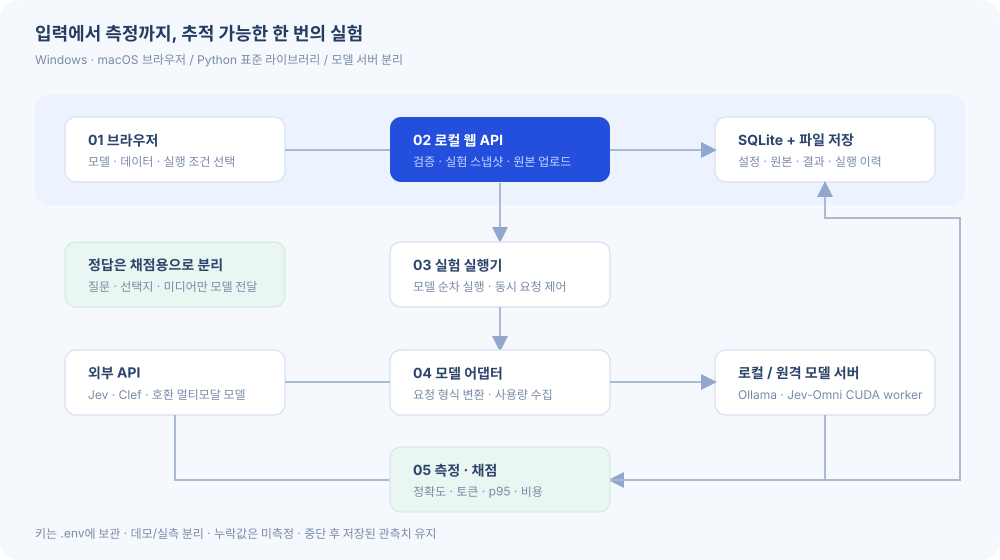

# Multimodal Bench · 멀티모달 모델 비교 실험실

이미지·오디오·영상·텍스트를 입력하는 판단 모델을 웹에서 비교합니다.
**기본 앱은 Python 표준 라이브러리만 사용합니다. Node.js, Docker, GPU는 필요하지 않습니다.**
브라우저는 Windows/macOS에서 동일한 화면을 사용합니다. 실제 추론은 외부 API 또는 별도 모델 서버가 담당합니다.



## 빠른 시작

Python 3.9 이상이 필요합니다. 새 설치에는 Python 3.12를 권장합니다.
두 운영체제 모두 기본 주소는 **http://127.0.0.1:8766** 입니다.

### Windows

```powershell
cd multimodal-bench
py -3 -m venv .venv
.\.venv\Scripts\python.exe run.py --open
```

또는 `start-windows.cmd`를 실행하세요. 가상환경이 없으면 자동으로 생성합니다.
PowerShell의 스크립트 실행 정책을 바꿀 필요 없이 가상환경의 Python을 직접 실행합니다.

### macOS

```sh
cd multimodal-bench
python3 -m venv .venv
.venv/bin/python run.py --open
```

또는 `sh start-macos.command`를 실행하세요. Finder에서 열려면 먼저 `chmod +x start-macos.command`를 적용합니다.
종료는 터미널에서 Ctrl+C입니다. 포트 충돌 시 `--port 8767`을 지정하세요.
기본 앱은 `requirements.txt`에 설치할 의존성이 없습니다.

## 첫 실험

1. 대시보드의 **데모 실험 실행**을 누릅니다.
2. 6개 차량 명령 문장에 대한 모의 결과를 확인합니다.
3. **종합 분석**에서 정확도, p50/p95, 입력 토큰, 확률 보정 그래프를 봅니다.
4. **개별 사례**에서 정답과 모델 응답, 원본 입력, 측정 근거를 확인합니다.
5. **실험 조건**에서 설정 스냅샷을 보고 CSV/JSON을 내려받습니다.

**DEMO는 해시로 만든 모의 응답입니다. 실제 AI 추론·실제 토큰 사용량·공개 벤치마크 성능이 아닙니다.**
데모 예측기는 정답을 읽지 않습니다. 데모와 실제 모델이 섞이면 화면에 경고 표시가 유지됩니다.

## 실제 모델 연결

`.env.example`을 `.env`로 복사하고 필요한 환경변수를 채운 뒤 서버를 재시작합니다.
**웹 화면에는 키 자체가 아닌 환경변수 이름만 입력합니다.**

| 연결 방식 | 기본 지원 | 설정 |
|---|---|---|
| TypeSafe Jev | 텍스트, PNG/JPEG 이미지 | `TYPESAFE_API_KEY`, 정확한 모델 ID |
| Cloudflare Clef/Clef-omni | 연결별 입력 지원 설정 | `CLOUDFLARE_API_TOKEN`, `CLOUDFLARE_ACCOUNT_ID` |
| SystemOne 호환 서버 | 서버가 지원하는 입력 | 전체 `/v1/systemone` 주소 |
| Ollama | 텍스트, 지원 모델의 이미지 | `http://127.0.0.1:11434/api/chat` 및 설치한 모델명 |
| OpenAI 호환 서버 | 텍스트, 지원 모델의 이미지/WAV/MP3 | 전체 chat completions 주소, 키 환경변수 |
| Jev-Omni 선택형 GPU worker | 텍스트, 이미지, 30초 이하 오디오, 무음 영상 프레임 | `workers/jev_omni_server.py` 실행 |

‘설정 완료’는 입력란과 환경변수가 준비됐다는 뜻입니다. 실제 연결 성공은 실험 실행 시 확인합니다.
외부 API를 선택하면 평가 자료가 그 제공자에게 전송됩니다.
OpenAI 호환이라는 이유만으로 오디오 입력이 지원되는 것은 아닙니다. 해당 모델의 지원 범위로 설정하세요.
원격 모델 서버는 HTTPS 주소를 사용합니다. HTTP는 루프백만 허용합니다.
외부 서버를 추가할 때 입력 형식·모델명·체크포인트 버전을 확인하세요.

### Jev-Omni GPU worker (선택 사항)

이 worker는 CUDA GPU 환경용입니다. **Mac에서 웹앱을 실행할 수 있다는 것과 Mac에서 CUDA 모델을 실행할 수 있다는 것은 다릅니다.**
macOS에서는 API/Ollama를 쓰거나 GPU 서버를 HTTPS 프록시 또는 SSH 터널로 연결합니다.

별도 Python 3.12 가상환경에서 CUDA 환경에 맞는 PyTorch와 `workers/requirements.txt`를 설치합니다.
FFmpeg와 ffprobe도 PATH에 준비해야 합니다. 웹앱의 가상환경과 분리하세요.

```sh
python -m venv .venv-worker
# 가상환경 활성화 후 CUDA에 맞는 torch를 먼저 설치하세요.
python -m pip install -r workers/requirements.txt
python workers/jev_omni_server.py --revision 검토한_40자리_커밋_SHA --port 9010
```

처음 실행하면 모델 파일을 다운로드하고 공식 저장소의 Python 코드를 실행합니다.
`--revision`은 실제 커밋 SHA로 고정해야 합니다. 코드의 기본 예시는 실재 SHA를 임의로 넣지 않습니다.
한 요청에 미디어 파일 하나와 choice 질문 하나만 처리합니다. 선택지 설명은 서로 달라야 합니다.
영상은 기본 16프레임으로 처리하며 영상 속 소리는 사용하지 않습니다.
`--video-frames`로 프레임 수를 바꿀 수 있습니다. 실험 시 다른 포트/모델 설정으로 구분해 기록하세요.
오디오는 30초 초과 시 잘라서 평가하지 않고 오류로 처리합니다.
실제 CUDA 모델 로딩은 기본 웹앱 테스트에 포함되지 않습니다.

## 데이터셋

1. 이미지·오디오·영상 파일을 먼저 업로드합니다.
2. **직접 만들기**에서 파일을 선택해 질문·선택지·정답을 등록하거나 JSON/JSONL/CSV를 가져옵니다.
3. 파일당 최대 20MiB, 데이터셋 최대 10,000개 샘플입니다.

```json
{
  "name": "오류 팝업 검사",
  "version": "1",
  "split": "test",
  "source": "직접 작성",
  "samples": [{
    "id": "screen-001",
    "text": "차량 설정 화면입니다.",
    "question": "오류 팝업이 표시되어 있나요?",
    "choices": {"yes": "예", "no": "아니요"},
    "label": "yes",
    "media_name": "screen-001.png",
    "tags": ["한국어", "설정 화면"],
    "group": "recording-001"
  }]
}
```

`media_name`은 이미 업로드한 파일 이름과 연결합니다. 동일 이름 파일이 여러 개면 오류가 나므로
`"assets": ["asset_..."]`로 정확한 ID를 지정하세요. 원격 미디어 URL이나 임의 로컬 경로를 직접 읽지 않습니다.
텍스트만 평가할 때는 미디어 참조를 생략합니다. `label`이 없으면 정확도를 계산하지 않습니다.
CSV의 `choices`, `assets`, `tags` 열은 JSON 문자열로 작성합니다.

### 공개 데이터 변환

```sh
python scripts/convert_dataset.py --format mmau --input mmau-test-mini.json --output converted/mmau
python scripts/convert_dataset.py --format mmbench --input MMBench_DEV_EN.tsv --output converted/mmbench
python scripts/convert_dataset.py --format mvbench --input action_sequence.json --output converted/mvbench
```

MMBench의 base64 이미지는 media 폴더로 추출합니다. MMAU/MVBench 미디어는 사용자가 준비합니다.
변환 후 해당 미디어를 업로드하고 `dataset.json`을 가져오세요.
원본의 분할명·버전을 수정해 기록하고, 데이터 이용 조건은 원본 배포처에서 확인하세요.
시간 구간이 있는 MVBench와 프레임 폴더형 과제는 별도 전처리가 필요합니다.
공식 리더보드의 전처리·채점기·선택지 순환 평가를 모두 재현하는 도구는 아닙니다.
따라서 기본 앱 결과는 **이 앱의 설정으로 평가한 결과**로 표시하고 공식 점수와 구분하세요.

## 측정 원칙

| 항목 | 구현한 기준 |
|---|---|
| 정확도 | 첫 반복의 정답 있는 성공 샘플 |
| 실패 포함 정답률 | 첫 반복의 지원되는 정답 샘플 중 맞힌 비율 |
| 공통 정답률 | 모든 선택 모델이 성공한 같은 샘플의 첫 반복 |
| Macro-F1 | 관측된 정답/예측 클래스별 F1 평균. 선택지 의미가 고정된 분류 과제용 |
| Brier | 다중 클래스 확률 제곱 오차의 합 평균, 범위 0~2 |
| ECE | 최대 선택지 확률 기준 10개 등폭 구간 |
| p50/p95 | 성공한 모든 측정 반복의 전처리+HTTP+정규화 시간 |
| 처리량 | 성공 판단 수 / 모델 실행 구간의 실제 경과 시간. 워밍업·중단 대기 제외 |
| 토큰 | 제공자 보고값 / 로컬 시퀀스 측정값 / 데모 추정값을 구분 |
| 비용 | 사용자가 입력한 토큰 단가에 따른 추정. 청구액·GPU 비용과 구분 |
| 실패·미지원 | 별도 집계. 미지원 모델을 정확도 0점으로 만들지 않음 |

외부 API의 내부 대기·GPU 시간은 알 수 없습니다. 누락 값을 0으로 추정하지 않습니다.
Jev-Omni worker의 로컬 시퀀스 길이는 모든 인코더 계산량을 나타내지 않습니다.
생성형 모델의 자기보고 확률은 ECE/Brier 계산에 사용하지 않습니다.
품질 지표는 첫 반복만 사용해 반복 요청으로 정답 표본 수를 부풀리지 않습니다.
이 버전은 통계적 신뢰구간을 계산하지 않습니다.
정확도와 보정 지표는 미지원·실패를 제외한 분모와 함께 해석하세요.
첫 반복에서 실패한 샘플의 후속 성공을 첫 반복 품질로 대체하지 않습니다.

## 중단·재개와 비용

중단은 진행 중인 요청이 끝난 후 적용합니다. 외부 제공자의 작업을 강제 취소하지 않습니다.
완료된 성공/오류/미지원 관측치는 재개할 때 다시 실행하지 않습니다. 재시도는 새 실험으로 수행하세요.
앱을 재시작하면 실행 중이던 실험은 ‘재개 가능’으로 표시됩니다.
강제 종료 구간은 전체 시간을 복원할 수 없어 재개된 실험의 처리량을 미측정으로 표시합니다.
워밍업도 API 비용이 발생할 수 있으며 JSON의 `warmup_log`에 별도로 기록됩니다.
실패 요청의 미보고 비용, 서버 임대료, 유휴 GPU 시간은 비용 추정에 포함되지 않습니다.
한 요청에 한 질문을 보내며 여러 질문을 한 번에 묶는 최적화는 구현하지 않았습니다.

## 코드 안내

| 파일 | 역할 |
|---|---|
| `run.py` | 공통 실행 진입점, 브라우저 열기 |
| `bench/server.py` | 정적 화면, HTTP API, 업로드, 내보내기 |
| `bench/datasets.py` | 데이터 검증과 정답 분리 |
| `bench/providers.py` | 모델별 요청/응답 변환과 측정값 수집 |
| `bench/runner.py` | 순차 모델 실행, 동시 요청, 중단·재개 |
| `bench/metrics.py` | 분모가 명시된 품질·시간·비용 계산 |
| `bench/storage.py` | SQLite 저장과 재시작 복구 |
| `web/app.js` | 화면 전환, 설정·결과 표시 |
| `web/guide.html` | 브라우저에서 읽는 구조도와 사용 설명 |
| `scripts/convert_dataset.py` | 공개 데이터 메타데이터 변환 |
| `workers/jev_omni_server.py` | 선택형 CUDA 모델 서버 |

상세 설계는 [docs/ARCHITECTURE.md](docs/ARCHITECTURE.md), 연결 방식과 실험 설계는 [docs/MODEL_GUIDE.md](docs/MODEL_GUIDE.md), 검증 기록은 [docs/VALIDATION.md](docs/VALIDATION.md)를 참고하세요.
가져오기를 연습할 텍스트 데이터셋은 `examples/custom-text.json`에 있습니다.

## 테스트와 Git

```sh
python -B -m unittest discover -s tests -v
python scripts/package.py
```

GitHub Actions는 Windows/macOS/Linux × Python 3.10/3.12 테스트 매트릭스로 구성했습니다.
워크플로 파일을 추가한 것이며 원격 CI를 실행한 것은 아닙니다.

```sh
git init
git add .
git commit -m "Add multimodal benchmark web application"
git branch -M main
git remote add origin YOUR_REPOSITORY_URL
git push -u origin main
```

`.env`, `.venv`, `data/`, 모델 가중치는 Git에서 제외됩니다. 패키징 도구도 소스 폴더만 포함합니다.
새 저장소의 공개 여부와 라이선스는 사용자가 결정할 수 있도록 임의의 라이선스를 부여하지 않았습니다.

## 범위와 다음 확장

현재 구현: 모델 설정, 실제 API 어댑터, 미디어 업로드, 데이터셋 검증, 일괄 실행,
동시 요청 1/4/16 조건 비교, 반복·워밍업, 중단·재개, SQLite 보존, 지표·그래프,
개별 사례·불일치 필터, JSON/CSV 내보내기, 공개 데이터 변환 도구.

후속 확장: 여러 질문을 묶는 요청, 이미지 리사이즈/영상 프레임 수의 웹 UI 자동 실험,
공식 벤치마크 채점기 통합, 정답 구간 주석 UI, 신뢰구간, 로그인·팀 공유.
기본 앱은 개인 PC의 로컬 사용을 대상으로 하며 인터넷 공개 운영용 인증을 제공하지 않습니다.

## 확인한 출처

- https://docs.typesafe.ai/models
- https://docs.typesafe.ai/images
- https://developers.cloudflare.com/workers-ai/models/clef-omni/
- https://huggingface.co/akhilaaa3/Jev-Omni
- https://huggingface.co/Cloudflare/clef-omni
- https://docs.ollama.com/api/chat
- https://github.com/open-compass/MMBench
- https://github.com/Sakshi113/MMAU
- https://github.com/OpenGVLab/Ask-Anything/blob/main/video_chat2/MVBENCH.md

연결 규약은 2026-10-25 확인한 자료를 기준으로 작성했습니다.
