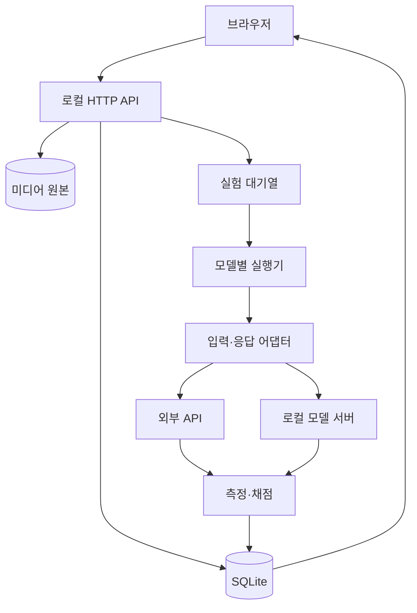
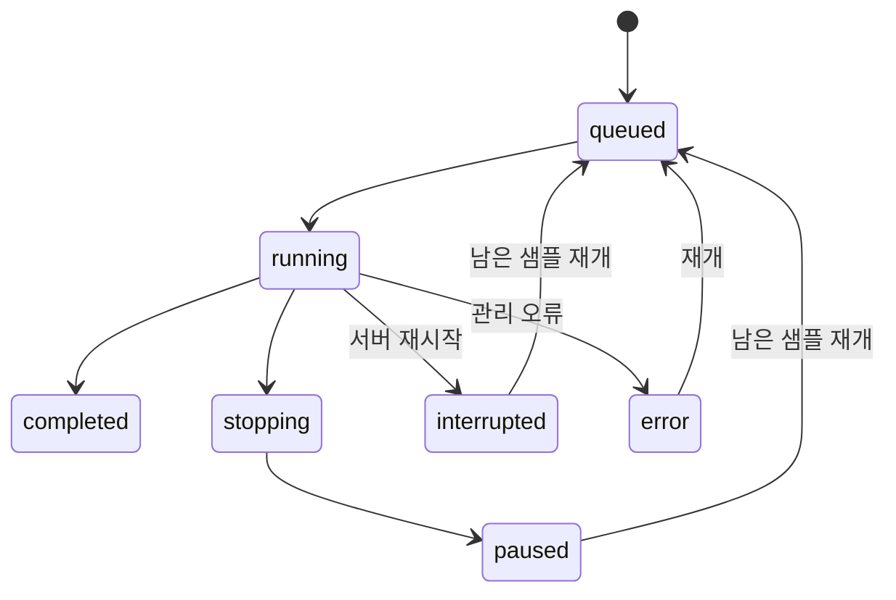
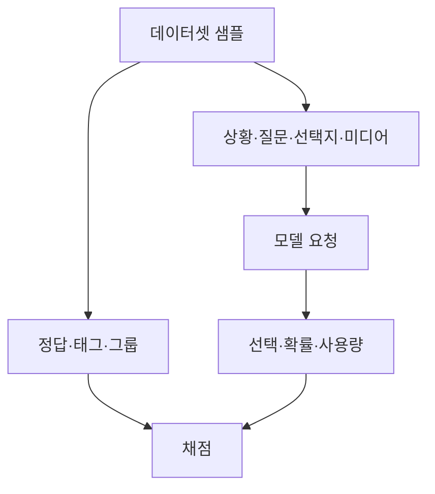

# 구조와 설계 의도

## 전체 처리

Windows와 macOS는 같은 Python 코드를 실행합니다. 브라우저에 가중치를 올리지 않습니다.
추론 서버와 앱 서버를 분리하므로 GPU가 없는 Mac에서도 외부 모델을 평가할 수 있습니다.
Redis/Celery 대신 표준 라이브러리의 대기열과 스레드를 사용해 설치 단계를 줄였습니다.
여러 사용자가 동시에 공유하는 서비스로 확장할 때 작업 대기열을 외부 서비스로 바꿀 수 있습니다.

## 실험 생명주기

일반적인 모델 요청 오류는 실험 전체를 실패시키지 않습니다. 해당 관측치에 오류를 저장하고 다음 요청을 실행합니다.
각 결과의 키는 `run_id + model_id + sample_id + repetition`입니다.
관측치 저장은 짧은 트랜잭션이고 모델 호출은 트랜잭션 밖에서 수행합니다.
강제 종료 직전 이미 제공자에게 보낸 요청의 비용은 복구할 수 없을 수 있습니다.

## 정답 분리

`inference_sample()`의 화이트리스트가 정답을 제거합니다.
데모 역시 모델에 주어진 입력만 사용합니다.
출력 분포가 불완전하거나 합이 맞지 않으면 추측해 채우지 않습니다.
생성 모델이 JSON으로 반환한 숫자 확신도는 보정된 확률로 간주하지 않습니다.

## 시간의 경계

- `preprocess_ms`: 앱이 원본을 읽고 base64와 요청 JSON을 구성하는 구간.
- `request_ms`: 모델 API의 왕복과 응답 JSON 읽기. 네트워크/서버 대기/추론이 섞입니다.
- `total_ms`: 위 과정과 결과 정규화·비용 계산을 포함합니다.
- `timings`: 제공자 또는 로컬 worker가 별도로 보고한 값. 미제공이면 빈 객체입니다.
- 처리량: 모델 구간의 실제 경과 시간으로 나눕니다. 동시 실행 요청의 개별 시간을 합산한 값으로 나누지 않습니다.

웹 파일 업로드 시간과 실험 대기열에서 앞선 실험을 기다린 시간은 `total_ms`에 포함하지 않습니다.
따라서 사용자 체감 전체 세션 시간과 요청당 처리 시간을 혼동하지 않아야 합니다.

## 데이터 구조

| 저장 객체 | 내용 |
|---|---|
| models | 연결 방식, 모델 ID, revision 메모, 키 환경변수 이름, 토큰 가격 |
| assets | 무작위 ID, 표시 이름, MIME, 크기, SHA256, 실제 원본 파일 |
| datasets | 샘플·정답·태그와 포맷 버전·분할·해시 |
| runs | 모델/데이터 스냅샷, 선택한 샘플 순서, 실행 설정과 상태 |
| results | 각 요청의 상태·답·확률·사용량·시간·오류 |

`.env`의 비밀키는 DB나 결과에 저장하지 않습니다.
JSON 내보내기에는 입력 텍스트·정답·응답 원문이 포함되므로 공유 전에 확인하세요.
미디어 파일 바이트는 JSON에 포함하지 않습니다. 다른 PC에서 재실행하려면 원본 미디어도 보존해야 합니다.

## API

| Method | 경로 | 역할 |
|---|---|---|
| GET | /api/bootstrap | 목록과 현재 세션 토큰 |
| POST | /api/models | 모델 생성/수정 |
| POST | /api/assets | base64 파일 업로드 |
| POST | /api/datasets | 평가 데이터 검증·등록 |
| GET | /api/datasets/{id} | 샘플 조회 |
| POST | /api/runs | 실험 등록 |
| GET | /api/runs/{id} | 결과와 집계 |
| POST | /api/runs/{id}/stop | 진행 중 요청 이후 중단 |
| POST | /api/runs/{id}/resume | 남은 관측치 실행 |
| GET | /api/runs/{id}/export | JSON 또는 ?format=csv |
| GET | /media/{asset_id} | 원본 미리보기, 영상 Range 지원 |

변경 요청에는 `X-Bench-Token` 헤더가 필요합니다.
루프백 Host만 허용하고 CORS를 열지 않으며 정적 파일의 경로 이탈과 CSV 수식 삽입을 방지합니다.
이 제한은 로컬 앱의 경계이며 사용자 인증을 대신하는 공개 서비스 설계가 아닙니다.
