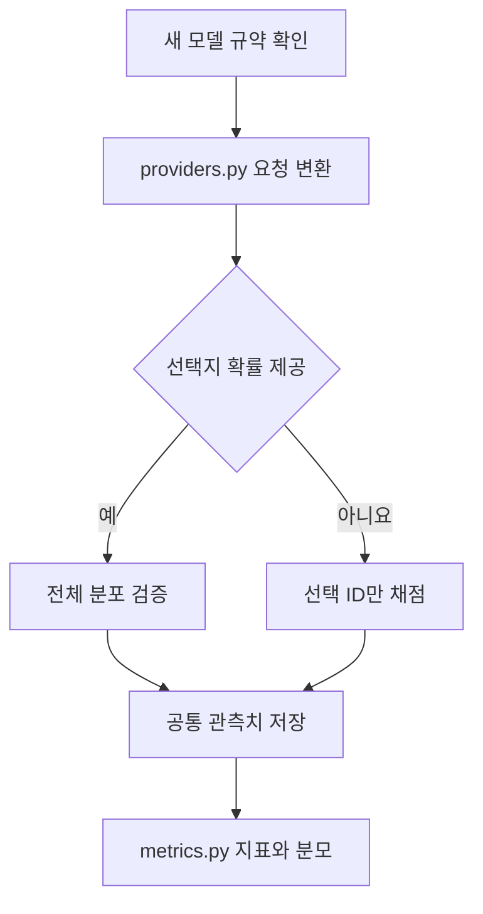

# 연결 방식과 비교 실험 설계

이 앱은 질문에 대한 선택지 판단을 비교합니다. 이미지·오디오·영상 생성 품질을 평가하는 도구는 아닙니다.
동일 모델 이름이라도 호스팅 제공자, 버전, 정밀도와 전처리에 따라 결과가 달라질 수 있습니다.

| 연결 | 판단 방식 | 입력과 기록 | 비교 시 주의점 |
|---|---|---|---|
| TypeSafe Jev | SystemOne choice 응답 | 텍스트·PNG/JPEG, 제공자 토큰과 선택지 확률 | 오디오·영상 직접 입력은 이 어댑터에서 제외 |
| Cloudflare Clef / Clef-omni | Workers AI의 SystemOne 응답 | 연결별 이미지·오디오·영상 지원, 보고된 usage | 모델별 지원 범위·컨텍스트·요금 확인 |
| Jev-Omni worker | 멀티모달 백본과 결정 헤드 | 고정 checkpoint, 입력 시퀀스 길이, 디코딩 프레임, GPU 메모리 | CUDA 별도 필요. 영상 오디오는 미사용 |
| Ollama / OpenAI 호환 | JSON 선택지 ID를 생성 | 모델별 입력 지원, 보고된 입력·출력 토큰 | 생성문에 적힌 확신도를 확률로 간주하지 않음 |
| DEMO | 입력 해시로 모의 판단 | 합성 확률, 문자열 기반 추정 토큰 | 실제 모델 성능 비교에서 제외 |

모델 크기·공개 벤치마크 점수는 API 응답으로 확인할 수 없는 경우가 있으므로 자동으로 채우지 않습니다.
`revision`, 설명, 실험 환경 메모에 체크포인트·서빙 정밀도·GPU·리전·전처리 조건을 기록하세요.
제공자의 공개 점수와 이 앱에서 측정한 점수는 같은 열에서 섞지 않는 것이 좋습니다.

## 권장 실험 묶음

| 실험 | 고정할 조건 | 변화시킬 조건 | 주요 결과 |
|---|---|---|---|
| 품질 비교 | 동일 샘플·선택지·첫 반복 | 모델 | 공통 정답률, 실패율, 사례별 불일치 |
| 속도 비교 | 동일 모델·데이터·API 리전 | 동시 요청 1/4/16 | p50/p95, 초당 판단 수 |
| 입력 조건 비교 | 동일 모델 버전 | 모달리티·길이·해상도 태그 | 조건별 정확도, 입력/출력 토큰 |
| 비용 비교 | 같은 업무 데이터와 정확도 조건 | 모델·제공자 | 1,000개 성공 판단 비용 추정 |

길이·해상도를 실험하려면 전처리한 파일을 별도 데이터셋으로 등록하고 태그를 붙입니다.
현재 웹 UI는 리사이즈나 영상 프레임 추출 설정을 자동 변경하지 않습니다.
공개 데이터 변환기는 원본 문제를 앱 포맷으로 옮기며 공식 채점기 전체를 재현하지 않습니다.

## 확장 지점

새 어댑터는 실제 제공되는 값만 기록해야 합니다. 토큰·연산 시간·확률의 누락 값을 0으로 채우지 마세요.
자세한 연결 자료는 README의 공식 출처 목록을 참고하세요.
